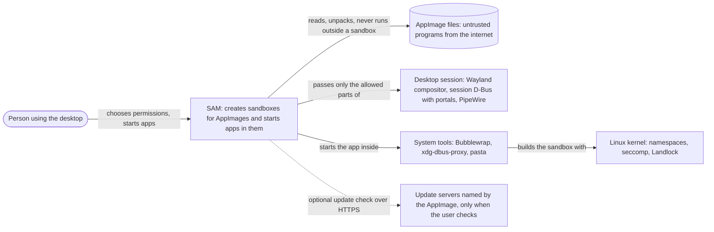
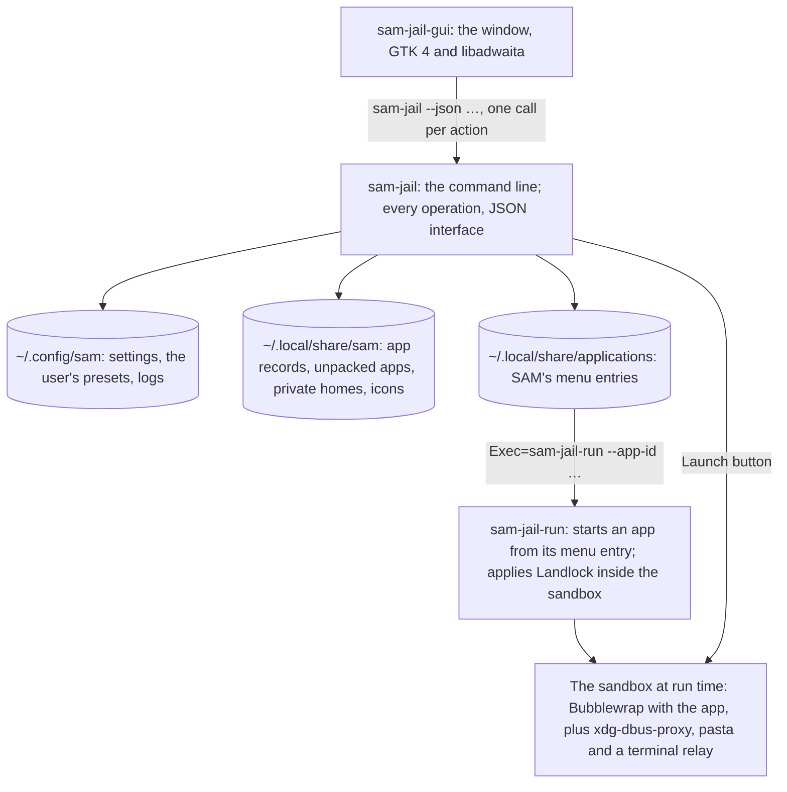
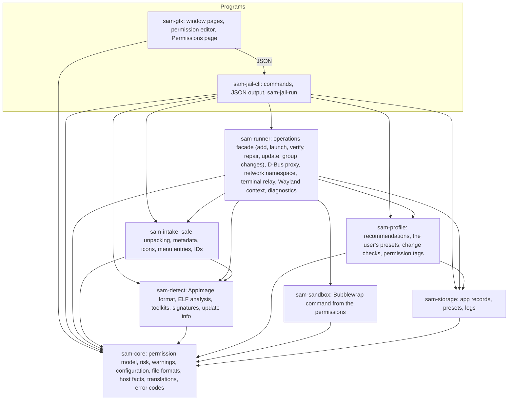

# Architecture (developer documentation)

This page describes SAM after the [C4 model](https://c4model.com/) in three
levels: SAM in its surroundings (context), the programs and stores SAM
consists of (containers), and the parts inside them (components). The code
itself is the fourth level. The sections after the overview explain the
interfaces in detail, and the [decision notes](#decision-notes) at the
end explain why SAM works as it does where the code cannot. Every part
named here has its tests listed in [the test library](test-library.md), and [SAM's functions](functions.md#components-and-their-functions)
shows which functions each component carries.

## Level 1: Context



A person uses SAM to turn an AppImage into an app that runs in a sandbox
with only the access that person allows. SAM treats every AppImage as
untrusted: it reads and unpacks the file itself and never runs it outside a
sandbox. The sandbox is built by Bubblewrap from the kernel's namespaces,
with a syscall filter and Landlock on top. Desktop services reach the app
only through filters: xdg-dbus-proxy for the session bus, a Wayland security
context for the compositor, and pasta for "this computer only". SAM goes
online only when the user asks for an update check or an update
([Network use by SAM itself](security.md#network-use-by-sam-itself)).

## Level 2: Containers



The window never changes SAM's files itself: every action is one call of
`sam-jail --json`, so the command line and the window always behave the same
and every action can be scripted and tested without a display. `sam-jail-run`
is what menu entries start; it reads the app record, builds the sandbox and
starts the app. Settings and the user's presets live in `~/.config/sam`; app
records, unpacked apps and the apps' private home folders live in
`~/.local/share/sam`. Sandboxed apps cannot see either folder.

## Level 3: Components



Every arrow is a real dependency; the test
`the_component_diagram_shows_the_real_dependencies` fails when the diagram
and the code disagree. The window uses sam-core only for shared names (the
permission catalog); everything it does goes through `sam-jail --json`.

| Component | Responsibility | Untrusted input it handles |
|---|---|---|
| sam-core | What a permission is, how risky it is, which warnings apply, the configuration and the versions of SAM's files; translations (gettext) and error codes | none (pure model) |
| sam-detect | Recognizes the AppImage format and what the program inside needs (libraries, toolkit, X11 or Wayland) | the AppImage file, ELF headers, start scripts |
| sam-intake | Unpacks an AppImage without running it, with limits on size, file count and time; reads name, icon and desktop file; writes menu entries | the squashfs or DwarFS image, desktop files, icons |
| sam-profile | Recommends permissions from what the app declares and contains; checks a change for what an app would lose; turns permissions into tags | metadata from the AppImage |
| sam-sandbox | Builds the Bubblewrap command line from a set of permissions | none (permissions are SAM's) |
| sam-runner | Carries out every operation and runs the helpers of a sandbox | the app's output (terminal relay), logs |
| sam-storage | Reads and writes app records, presets and logs; moves damaged files aside | SAM's own files, possibly changed by others |
| sam-jail-cli | Turns commands into operations and results into text or JSON | command-line arguments, JSON on stdin |
| sam-gtk | Shows the results and asks the user; contains no sandbox logic | none (talks only to sam-jail) |

The trust boundary runs at sam-detect and sam-intake: everything taken from
an AppImage is treated as data, never as code or as trusted text (markup is
neutralized before it is shown). The parsers there are fuzzed
(`crates/sam-runner/tests/fuzz.rs`, see the [threat model](threat-model.md)).

## Texts and languages

Every text a person reads is translated where it is made, with
`sam_core::i18n` (gettext, text domain `sam`); the window shows the
messages of the command line as they come. Because the texts are
translated, no code may decide anything by comparing a message: an error that
code must recognize carries a code (`sam_core::error::CodedError`), which the
JSON envelope passes on as `"code"`. Logs, codes and the JSON keys stay
English. [Translating SAM](translating.md) has the details.

## GUI ↔ core

The GUI (`crates/sam-gtk`) is a GTK 4 / libadwaita window. Each operation runs
`sam-jail --json <args>` asynchronously. When a command needs a full profile,
preset or config, the GUI sends it as JSON on stdin (`profile set`,
`preset put`, `config put`, `evaluate`). Every response is a single envelope:

```json
{"ok": true, "data": …}
{"ok": false, "error": "a message in the user's language", "code": "signing-key-changed"}
```

`code` is present only for errors the window must recognize.

Apps are launched detached with `sam-jail-run --app-id <id>`, the same command
the desktop launchers use, so apps keep running when SAM closes. The GUI
links no SAM crate except `sam-core` (for the permission catalog and the
translations): the CLI is the API.

In developer builds, `sam-jail-gui --screenshot out.png [--size WxH] [--page …]` renders the
window once it has loaded (with `GDK_BACKEND=broadway` it works without a
desktop), and saves the scrollable content of the right column as
`out-content.png`.

## Sandbox command builder

SAM has one sandbox: Bubblewrap. `sam_sandbox::Bubblewrap` has two
functions:

```rust
impl Bubblewrap {
    pub fn status(&self, host: &HostInfo) -> BubblewrapStatus;         // installed / usable / notes
    pub fn build(&self, ctx: &LaunchContext) -> Result<SandboxCommand>;
}
```

`LaunchContext` holds everything needed to build a sandbox: the AppDir, the
entry point, the permission set, the host probe, the private home, the runtime
dir, the AppImage environment (`APPDIR`, `APPIMAGE`, `OWD`, …), the D-Bus
proxy socket, the Landlock helper, the seccomp fd, the tracer and extra binds.

## Launch pipeline

1. **Preflight:** the extraction exists; warn if the source is stale or missing.
2. **Bubblewrap check:** `bwrap.rs` verifies Bubblewrap can run here (installed,
   user namespaces allowed) or stops with a hint.
3. **Runtime dir:** generated `passwd` and `group`, an `xdg-dbus-proxy` for a
   filtered bus, the Landlock spec, and Room service's socket and stand-in
   (`room_service.rs`).
4. **Build and spawn:** `Bubblewrap::build` produces the command, and stdout and
   stderr are teed into `~/.config/sam/logs/<id>/launch-*.log`. The command
   is also the app's *floor plan* for Room service (`room_rules.rs`), which
   then serves the app's requests for rooms until the start ends.
5. **Record:** exit code or signal, plus a sandbox-failure classification (a
   `bwrap:` error, exit 126 or 127), and a line per room built or refused.
   Every room ends before SAM waits for the app's output. The result goes
   into `AppEntry.last_launch` and the badge.

## Data model

See `crates/sam-core/src/model.rs`: `AppEntry`, `AppImageMetadata`,
`ExtractionInfo`, `DependencyReport`, `SandboxProfile`, `Preset`,
`LaunchRecord` and `DiagnosticReport`. The app registry stores one JSON file
per app; presets and the config are stored as TOML.

## Tests

The complete list, with what each test proves, is the
[test library](test-library.md) (`scripts/test-library.py`).

- `cargo test --workspace`: unit tests in every crate.
- `crates/sam-runner/tests/sandbox.rs`: the end-to-end test. It builds a
  probe AppImage, adds it, launches it under several profiles, and checks from
  inside the sandbox what is visible and writable. Where Bubblewrap cannot
  run it skips itself, except in CI and `make test`, where
  `SAM_REQUIRE_SANDBOX=1` turns that skip into a failure.
- `sam-jail dev make-fixture <path> [--name] [--categories] [--apprun file]`
  builds synthetic AppImages for manual testing.
- `sam-jail-gui --screenshot out.png --page <page>` (with
  `GDK_BACKEND=broadway`) renders the window without a desktop.
- Both are in developer builds only, like the other test and release tools;
  release builds have them only with the `dev-tools` feature
  ([Testing](testing.md)).
- `scripts/function-map.py` checks that every function has its tests and
  writes [functions.md](functions.md); `scripts/i18n.py check` keeps the
  three translations complete. [Testing](testing.md) explains the rest.

## Decision notes

A decision note records why SAM works the way it does where the reason is
not visible in the code: the decision, the risk it answers, what it costs
in the five columns, what was rejected, and where the code enforces it.
Where the owner has not decided yet, the heading starts with *Proposal*
and the text names the open decision. Line numbers are those of the
commit that added the note; the function names stay valid when lines
move.

### Proposal: every extra socket is rated Dangerous

**Decided (owner decision 11, 2026-11-23).** The SSH agent and gpg-agent
sockets are rated *Dangerous*, because an app with an unlocked agent can
decrypt or log in as you. That is the whole decision.

**How SAM carries out decision 11 today.** SAM rates the SSH agent
switch *Dangerous*, and every extra socket whose name is a key agent's:
GnuPG's agent or an SSH agent at its usual places. SAM also counts such
a socket as reading your keys, so together with the network it adds
*Can send what it reads*; the code cites decision 11 for this, but the
decision itself does not mention it.

**Proposed, not yet decided.** SAM rates every extra socket
(`sockets.custom`) *Dangerous*, whatever its name. Today SAM rates an
extra socket *Think twice* unless its name is on SAM's list of dangerous
sockets (Docker, Podman, containerd, the system bus, any D-Bus socket,
systemd, libvirt, the sound server's own connection, a key agent). The
open decision for the owner is whether the rating stops depending on that
list.

**Why.** A socket is a door into another program that runs outside the
sandbox with all of your rights. What the app can do through it depends
entirely on that program, and SAM cannot see that program's rules. Through
a key agent the app decrypts, signs and logs in to other computers as you,
without ever knowing the keys. Through Docker's socket it controls the
whole computer, and through a tmux socket it runs commands outside the
sandbox. A list of dangerous names can never be complete: a socket SAM
does not know, or a known one under a new name, reads only *Think twice*
although it can be as harmful as Docker's.

**What it costs.** Compatibility: nothing stops working, because SAM
still passes an extra socket in, and SAM already asks first for a change
that adds one from *Think twice* on. Every app with an extra socket, such
as a password manager's browser connection, then reads *Dangerous*, which
makes the word weigh less for the apps that need it. Simplicity: the
rating becomes one rule instead of a list that each review extends. The
list does not go away on its own: SAM also uses it to refuse an extra
socket whose link leads to a socket on the list of another kind than the
name you listed, and uses the key agent names for *Can send what it
reads*. Those two uses need their own rule before SAM can drop the list.

**Rejected in the proposal, not decided.** Under the proposal, SAM would
not keep the list as the only rating, because a list of names misses
every dangerous socket SAM does not know yet. Nor would SAM refuse extra
sockets altogether, because some apps need exactly one socket, and the
setting exists for them. The owner has decided neither.

**Where the code enforces it.**
- The SSH agent switch: `assess` in
  [`crates/sam-core/src/risk.rs`](../crates/sam-core/src/risk.rs#L511),
  line 511.
- The extra sockets, *Dangerous* by the list and *Think twice* otherwise:
  [`risk.rs`](../crates/sam-core/src/risk.rs#L522), line 522.
- Asking first from *Think twice* on: `waits_for_yes`,
  [`risk.rs`](../crates/sam-core/src/risk.rs#L158), line 158.
- Key agents as reading your keys:
  [`risk.rs`](../crates/sam-core/src/risk.rs#L612), line 612.
- The key agent names: `key_agent_socket` in
  [`crates/sam-core/src/permissions.rs`](../crates/sam-core/src/permissions.rs#L433),
  line 433; the list of dangerous sockets: `dangerous_socket_reason`,
  [line 482](../crates/sam-core/src/permissions.rs#L482), and its kinds:
  `dangerous_socket_kind`,
  [line 472](../crates/sam-core/src/permissions.rs#L472).
- The link check that compares the kinds: `Section::sockets` in
  [`crates/sam-sandbox/src/lib.rs`](../crates/sam-sandbox/src/lib.rs#L2962),
  line 2962.
- Tests: `key_agents_are_rated_dangerous`,
  `a_key_agent_socket_with_the_network_can_send_what_it_reads`,
  `an_extra_socket_is_passed_in_only_as_dangerous_as_its_name`.

### Proposal: dropping raw Bubblewrap arguments and other name lists

**Proposed, not yet decided.** SAM removes the setting *Raw Bubblewrap
arguments* (`advanced.extra_bwrap_args`, called `extra_backend_args` in
profiles from before 0.2), together with the code that exists only to
guard it. The independent review before the beta proposed this deletion
and further removals of name lists; on 2026-11-26 the owner put them on
the roadmap as decision notes first, without changing code. The open
decision for the owner is whether SAM drops the setting, and what SAM
does with a saved profile that still has it.

**Why.** The setting passes any words straight to Bubblewrap, so a single
argument undoes the sandbox: `--bind / /` shows the whole computer to the
app, and `--share-net` gives it the network while every switch says
otherwise. SAM keeps several protections for this one setting, and
reviews have found new gaps in them: a change of the arguments did not
ask again, and an argument missing its values took SAM's own
last arguments and left the sandbox root writable. Each
protection is code that must be kept correct for a setting few people
use.

**What it costs.** Compatibility: a power user loses the way to add a
mount or option that SAM has no setting for, and an app that needs one
must wait for a real setting. A saved profile with raw arguments must not
start silently without them; SAM would name the setting it no longer
applies. Simplicity: the rating, the second question, the check before
the start, the warning, the old name and the setting in the window go
away. Testing: four test files plant a weakened sandbox through raw
arguments to prove that the sandbox check notices it (`exit_codes.rs`,
`menu_notice.rs` and `start_check.rs` in `crates/sam-jail-cli/tests/`,
and `verify.rs` in `crates/sam-runner/tests/`); they need another way to
plant it, available in test builds only. Two more use raw arguments for
other ends: `breakout.rs` mounts a read-only folder writable to prove
that Landlock still holds, and `room_service.rs` proves that SAM builds a
room when the person's own arguments cut the network.

**Rejected in the proposal, not decided.** Under the proposal, SAM would
not keep the setting as it is, because the protections around it have
needed fixes after reviews. Nor would SAM offer an allow list of harmless
options, because that is one more name list, and options that look
harmless, such as `--bind`, still undo the sandbox. The owner has decided
neither.

**Other name lists.** SAM changes no code for a further name list before
that list has a decision note of its own. Candidates SAM has today: the
list of dangerous sockets, if the socket rule above is decided, and the
old name `extra_backend_args`. SAM's table of Bubblewrap options stays in
any case, because SAM also uses it to show a command, and a test keeps
Room service's own table of options to the same numbers. The complexity
map on the roadmap decides further candidates from evidence.

**Where the code enforces it.**
- The setting: the `extra_bwrap_args` field of `AdvancedPerms` (the
  struct at
  [`crates/sam-core/src/permissions.rs`](../crates/sam-core/src/permissions.rs#L817),
  line 817; the field at
  [line 848](../crates/sam-core/src/permissions.rs#L848)), and its entry
  in the permission catalogue,
  [line 1315](../crates/sam-core/src/permissions.rs#L1315), rated
  *Dangerous*.
- The old name: the `extra_backend_args` alias,
  [`permissions.rs`](../crates/sam-core/src/permissions.rs#L847),
  line 847.
- The rating: `assess` in
  [`crates/sam-core/src/risk.rs`](../crates/sam-core/src/risk.rs#L540),
  line 540; the second question on any change: `new_risks`,
  [line 133](../crates/sam-core/src/risk.rs#L133).
- The check before the start: `Bubblewrap::build` in
  [`crates/sam-sandbox/src/lib.rs`](../crates/sam-sandbox/src/lib.rs#L1960),
  line 1960, with `raw_problem`,
  [line 3203](../crates/sam-sandbox/src/lib.rs#L3203); the arguments
  are passed on in `finish_command`,
  [line 3154](../crates/sam-sandbox/src/lib.rs#L3154).
- The warning:
  [`crates/sam-core/src/warnings.rs`](../crates/sam-core/src/warnings.rs#L476),
  line 476.
- The setting in the window:
  [`crates/sam-gtk/src/perms.rs`](../crates/sam-gtk/src/perms.rs#L848),
  line 848.
- The table of Bubblewrap options: `BWRAP_OPTIONS` in
  [`crates/sam-core/src/sandbox.rs`](../crates/sam-core/src/sandbox.rs#L134),
  line 134; showing a command with it: `bwrap_arity` in
  [`crates/sam-jail-cli/src/output.rs`](../crates/sam-jail-cli/src/output.rs#L136),
  line 136; Room service's own table: `option` in
  [`crates/sam-runner/src/room_rules.rs`](../crates/sam-runner/src/room_rules.rs#L103),
  line 103, kept to the same numbers by
  `rooms_and_raw_arguments_count_option_values_alike`.
