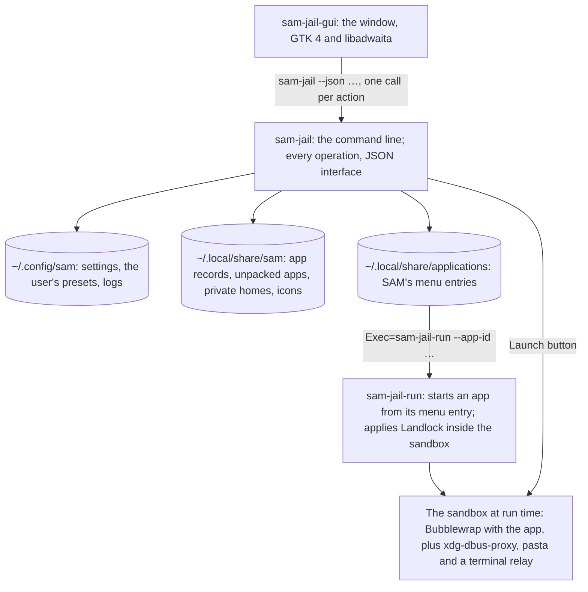

# Architecture (developer documentation)

This page describes SAM after the [C4 model](https://c4model.com/) in three
levels: SAM in its surroundings (context), the programs and stores SAM
consists of (containers), and the parts inside them (components). The code
itself is the fourth level. The sections after the overview explain the
interfaces in detail. Every part named here has its tests listed in
[the test library](test-library.md).

## Level 1: Context


A person uses SAM to turn an AppImage into an app that runs in a sandbox
with only the access that person allows. SAM treats every AppImage as
untrusted: it reads and unpacks the file itself and never runs it outside a
sandbox. The sandbox is built by Bubblewrap from the kernel's namespaces,
with a syscall filter and Landlock on top. Desktop services reach the app
only through filters: xdg-dbus-proxy for the session bus, a Wayland security
context for the compositor, and pasta for "local network only". SAM contacts
the internet only when the user checks for updates, and only the addresses
the AppImage names.

## Level 2: Containers



The window never changes SAM's files itself: every action is one call of
`sam-jail --json`, so the command line and the window always behave the same
and every action can be scripted and tested without a display. `sam-jail-run`
is what menu entries start; it reads the app record, builds the sandbox and
starts the app. Settings and the user's presets live in `~/.config/sam`; app
records, unpacked apps and the apps' private home folders live in
`~/.local/share/sam`. Sandboxed apps cannot see either folder.

## Level 3: Components

```mermaid
flowchart TB
    subgraph clients[Programs]
        gtk[sam-gtk: window pages, permission editor, Permissions page]
        clic[sam-jail-cli: commands, JSON output, sam-jail-run]
    end
    runner[sam-runner: operations facade (add, launch, verify, repair, update, group changes), D-Bus proxy, network namespace, terminal relay, Wayland context, diagnostics]
    intake[sam-intake: safe unpacking, metadata, icons, menu entries, IDs]
    detect[sam-detect: AppImage format, ELF analysis, toolkits, signatures, update info]
    profile[sam-profile: recommendations, the user's presets, change checks, permission tags]
    sandbox[sam-sandbox: Bubblewrap command from the permissions]
    storage[sam-storage: app records, presets, logs]
    core[sam-core: permission model, risk, warnings, configuration, file formats, host facts]
    gtk -->|JSON| clic
    clic --> runner
    runner --> intake
    runner --> detect
    runner --> profile
    runner --> sandbox
    runner --> storage
    intake --> core
    detect --> core
    profile --> core
    sandbox --> core
    storage --> core
```

| Component | Responsibility | Untrusted input it handles |
|---|---|---|
| sam-core | What a permission is, how risky it is, which warnings apply, the configuration and the versions of SAM's files | none (pure model) |
| sam-detect | Recognizes the AppImage format and what the program inside needs (libraries, toolkit, X11 or Wayland) | the AppImage file, ELF headers, start scripts |
| sam-intake | Unpacks an AppImage without running it, with limits on size, file count and time; reads name, icon and desktop file; writes menu entries | the squashfs or DwarFS image, desktop files, icons |
| sam-profile | Recommends permissions from what the app declares and contains; checks a change for what an app would lose; turns permissions into tags | metadata from the AppImage |
| sam-sandbox | Builds the Bubblewrap command line from a set of permissions | none (permissions are SAM's) |
| sam-runner | Carries out every operation and runs the helpers of a sandbox | the app's output (terminal relay), logs |
| sam-storage | Reads and writes app records, presets and logs; moves damaged files aside | SAM's own files, possibly changed by others |
| sam-jail-cli | Turns commands into operations and results into text or JSON | command-line arguments, JSON on stdin |
| sam-gtk | Shows the results and asks the user; contains no sandbox logic | none (talks only to sam-jail) |

The trust boundary runs at sam-detect and sam-intake: everything taken from
an AppImage is treated as data, never as code or as trusted text (markup is
neutralized before it is shown). The parsers there are the targets of the
fuzzing planned for the security phase.

## GUI ↔ core

The GUI (`crates/sam-gtk`) is a GTK 4 / libadwaita window. Each operation runs
`sam-jail --json <args>` asynchronously. When a command needs a full profile,
preset or config, the GUI sends it as JSON on stdin (`profile set`,
`preset put`, `config put`, `evaluate`). Every response is a single envelope:

```json
{"ok": true, "data": …}
{"ok": false, "error": "human readable message"}
```

Apps are launched detached with `sam-jail-run --app-id <id>`, the same command
the desktop launchers use, so apps keep running when SAM closes. The GUI
links no SAM crate except `sam-core` (for the dangerous D-Bus name list):
the CLI is the API.

`sam-jail-gui --screenshot out.png [--size WxH] [--page …]` renders the
window once it has loaded (with `GDK_BACKEND=broadway` it works without a
desktop), and saves the scrollable content of the right column as
`out-content.png`.

## Sandbox command builder

SAM has one sandbox: Bubblewrap. `sam_sandbox::Bubblewrap` has two
functions:

```rust
impl Bubblewrap {
    pub fn status(&self, host: &HostInfo) -> BubblewrapStatus;         // installed / usable / notes
    pub fn build(&self, ctx: &LaunchContext) -> Result<SandboxCommand>;
}
```

`LaunchContext` holds everything needed to build a sandbox: the AppDir, the
entry point, the permission set, the host probe, the private home, the runtime
dir, the AppImage environment (`APPDIR`, `APPIMAGE`, `OWD`, …), the D-Bus
proxy socket, the Landlock helper, the seccomp fd, the tracer and extra binds.

## Launch pipeline

1. **Preflight:** the extraction exists; warn if the source is stale or missing.
2. **Sandbox check:** `bwrap.rs` verifies Bubblewrap can run here (installed,
   user namespaces allowed) or stops with a hint.
3. **Runtime dir:** generated `passwd` and `group`, an `xdg-dbus-proxy` for a
   filtered bus, and the Landlock spec.
4. **Build and spawn:** `Bubblewrap::build` produces the command, and stdout and
   stderr are teed into `~/.config/sam/logs/<id>/launch-*.log`.
5. **Record:** exit code or signal, plus a sandbox-failure classification (a
   `bwrap:` error, exit 126 or 127). The result goes into
   `AppEntry.last_launch` and the badge.

## Data model

See `crates/sam-core/src/model.rs`: `AppEntry`, `AppImageMetadata`,
`ExtractionInfo`, `DependencyReport`, `SandboxProfile`, `Preset`,
`LaunchRecord` and `DiagnosticReport`. The app registry stores one JSON file
per app; presets and the config are stored as TOML.

## Tests

The complete list, with what each test proves, is the
[test library](test-library.md) (`scripts/test-library.py`).

- `cargo test --workspace`: unit tests in every crate.
- `crates/sam-runner/tests/sandbox.rs`: the end-to-end test. It builds a
  probe AppImage, adds it, launches it under several profiles, and checks from
  inside the sandbox what is visible and writable. It skips itself when bwrap
  cannot run.
- `sam-jail dev make-fixture <path> [--name] [--categories] [--apprun file]`
  builds synthetic AppImages for manual testing.
- `sam-jail-gui --screenshot out.png --page <page>` (with
  `QT_QPA_PLATFORM=offscreen`) renders the GUI headlessly.
