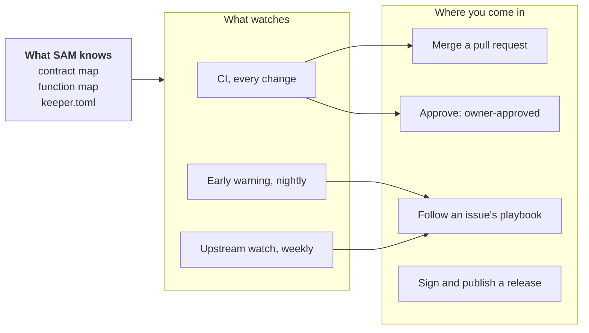

# How SAM looks after itself

SAM depends on a Linux world that keeps changing: Bubblewrap, the kernel,
the desktops, the distributions. Keeping up with that used to need a team.
SAM instead watches itself, finds what changed, names the exact part, and
asks you only where your judgment is needed. This page shows the whole
machine on one page; the other pages explain each part.

## The machine in one picture

## What runs without you

| What | When | What it tells you |
|---|---|---|
| **The tests** (logic, sandbox, attacks, window under KDE and GNOME) | every change | a red check names the part: `CHECK FAIL breakout/landlock`, or `CONTRACT BROKEN: …` when the outside world changed |
| **The maps** (functions, contracts, test library) | every change | nothing goes into the code without a promise, a test and a contract |
| **The contract verifier** | every pull request | whether a change weakens a promise ("Needs your approval") |
| **The early warning** | every night | a contract broken on a distribution users will get in weeks or months: one issue, closed by itself when it is fixed |
| **The upstream watch** | every Monday | release notes that mention what SAM relies on |
| **What changed outside** | when a run on `main` fails | the versions and contract states that differ from the last green run |
| **Dependabot** | weekly | updates of SAM's building blocks as pull requests |

## Where you are needed, and why

| Moment | What you do | Why only you |
|---|---|---|
| A pull request is green | merge it | every change to SAM passes you |
| **Needs your approval** is red | read its list; if it is right, set `owner-approved` | it weakens a promise, changes a protected test or adds a dependency: that is a decision, not a check |
| An `early-warning` or `upstream-change` issue opens | follow the contract's playbook ([When something outside SAM changes](outside.md)), or ask Claude with the issue's link | the issue holds everything needed |
| A security report arrives (Security tab) | answer within a week, fix first | it is about users' safety |
| A release is due | `scripts/new-version.sh X.Y.Z`, then publish the draft | only you hold the release key |

## Your weekly routine (about 15 minutes)

1. **GitHub → Issues:** anything labelled `early-warning` or
   `upstream-change`? Open it; it says which contract, what was found and
   what to do.
2. **Pull requests:** merge the green ones; for a red "Needs your approval",
   read its summary and decide.
3. **Security tab:** any report? Then that comes first.
4. Nothing there? SAM is fine. That is the normal week.

## The safety nets

- **Branch protection:** nothing reaches `main` without a pull request and
  seven green checks, for you too.
- **Tag protection:** only you can start a release.
- **The kill switch:** the repository variable `SAM_AUTOMATION` (`off`,
  `proposals`, `on`) stops every automated workflow at once.
- **Everything fails safe:** when a contract breaks, SAM refuses, falls back
  to less access, or warns; it never quietly gives an app more.

The rules for all automation, and what it may never do, are in
[AUTOMATION.md](../../AUTOMATION.md). How SAM will one day be maintained by a
reusable tool is planned there too (its last phase).
